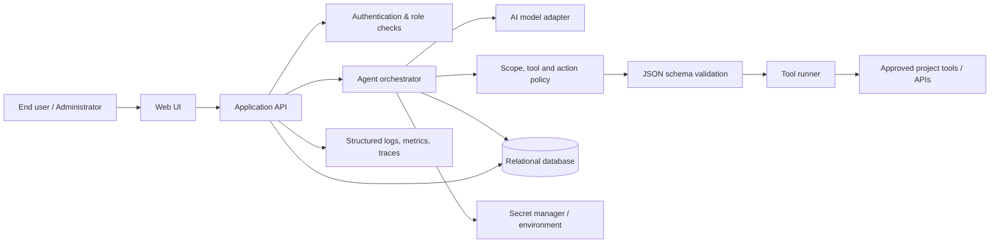
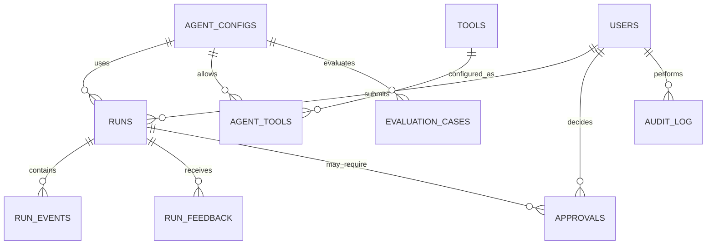

# AI Agent — High-Level and Low-Level Design

**Version:** 1.0  
**Basis:** `AI_Agent_SRS.txt` (prototype scope)  
**Design assumption:** The target runtime remains configurable for one focused task domain and a small tool allowlist. The browser prototype uses workspace setup and support guidance as its example domain. It includes sample help/account handlers, identifies workspace verification as unavailable, and shows a ticket approval preview without a ticket adapter.

## 1. Scope and design goals

The application accepts text requests, asks a model to respond or select an approved tool, validates and executes that tool, optionally returns its result to the model, and presents a final answer. Consequential actions pause for explicit user confirmation. Administrators configure the task instructions, tool catalog, and runtime settings.

The proposed target architecture is intentionally bounded: tool execution is server-side, tool schemas are validated, secrets never reach the browser, and each run has a traceable lifecycle. The current files implement a browser-only deterministic prototype, not that server runtime: there is no model SDK, API service, live account adapter, workspace verifier, or ticket service. The interface includes Agent Chat, Overview, Agent Playground, Runs, Tools, and Settings; each page includes its own interactive 3D-style dashboard.

## 2. High-level design (HLD)

### 2.1 Logical architecture



### 2.2 Components and responsibilities

| Component | Responsibility |
|---|---|
| Web UI | Request composer, response stream/display, confirmation dialog, run history, and administrator pages. |
| Application API | Authenticates callers, validates request shape, enforces per-user access, exposes run/configuration endpoints. |
| Agent orchestrator | Builds bounded model context, manages model/tool turns, applies step/time limits, records run state, assembles final response. |
| Model adapter | Provider-neutral interface for sending messages and tool definitions; normalizes provider errors and tool-call responses. |
| Policy service | Enforces configured task scope, tool allowlist, consequential-action confirmation, and configured limits. |
| Tool registry and runner | Resolves only enabled tools, validates arguments against registered JSON Schema, applies timeout/retry policy, invokes server-side adapters. The deterministic prototype now uses one adapter registry for plan matching and dispatch. |
| Workspace verification adapter | Optional server-side adapter with a separate authorization check. It reports live success only when the authorized backend confirms the requested workspace; missing adapters, denied access, mismatched workspace IDs, timeouts, and unconfirmed responses cannot become success. |
| Persistence | Stores agent configuration, tool metadata, runs, events, approvals, and operational audit records. Does not store credentials in plaintext. |
| Observability | Correlation IDs, latency/error metrics, and redacted structured logs. Never logs secrets or full sensitive payloads by default. |

### 2.3 Runtime sequence

```mermaid
sequenceDiagram
  actor User
  participant UI as Web UI
  participant API as Application API
  participant Agent as Orchestrator
  participant Model as Model service
  participant Policy as Policy + validator
  participant Tool as Approved tool
  participant DB as Database
  User->>UI: Submit request
  UI->>API: POST /runs
  API->>DB: Create run (queued)
  API->>Agent: Start run with correlation ID
  Agent->>DB: Mark running; append user event
  Agent->>Model: Instructions + conversation + tool descriptions
  Model-->>Agent: Answer or tool call
  alt Tool call selected
    Agent->>Policy: Check allowlist, schema, scope
    Policy-->>Agent: Validated arguments
    alt Consequential action
      Agent->>DB: Store pending approval
      Agent-->>UI: Awaiting confirmation
      User->>UI: Confirm or cancel
      UI->>API: POST /approvals/{id}
      API->>Agent: Resume or cancel
    end
    Agent->>Tool: Execute approved call
    Tool-->>Agent: Result or normalized error
    Agent->>DB: Append tool event
    Agent->>Model: Tool result for follow-up
    Model-->>Agent: Final answer or next call
  end
  Agent->>DB: Store final response/status
  Agent-->>UI: Final response or helpful error
  UI-->>User: Display result
```

### 2.4 Deployment view

For the hackathon prototype, deploy a single web frontend and a stateless API/orchestrator service, with a managed PostgreSQL database and a managed secret store (or environment-injected secrets for local demo). Tool adapters run inside the server process or as isolated workers. The browser communicates only with the application API. A production deployment can split the worker queue and tool runner without changing the external API contract.

### 2.5 Quality and safety decisions

- Use a configured `max_tool_calls`, `max_turns`, and run timeout to bound execution.
- Treat model output as untrusted. A tool call is a request, never authorization.
- Check tool enabled state, input schema, user/agent scope, and confirmation requirement before execution.
- Mark consequential operations as `awaiting_confirmation`; execute only after a valid approval from the initiating user.
- Return stable error codes with plain-language messages. Keep provider stack traces and credentials out of user responses.
- State source/verification limits clearly; tool results are represented as tool output, not automatically as independently verified truth.
- Keep support documentation separate from configuration and permission verification. The browser demo has an explicitly labeled unavailable/demo workspace adapter; live verification needs a trusted server-side backend and authorization provider.
- Redact secrets and configurable sensitive fields from application logs.

## 3. Low-level design (LLD)

### 3.1 Core entities and relationships



### 3.2 Relational database design

PostgreSQL is the reference database. The executable schema is in [`database/schema.sql`](database/schema.sql).

| Table | Purpose | Key fields / constraints |
|---|---|---|
| `users` | Application identities and roles. | `id` UUID PK; unique normalized `email`; role is `admin` or `user`; active flag. |
| `agent_configs` | Versioned agent instructions and runtime policy. | `id` UUID PK; `name`; `version`; `instructions`; JSONB `settings`; `is_active`; unique `(name, version)`. Secrets are references, never values. |
| `tools` | Globally registered server-side tool adapters. | `id` UUID PK; unique `key`; description; JSONB input schema; consequential flag; timeout; adapter key; enabled flag. |
| `agent_tools` | Allowlist mapping for a config version. | Composite PK `(agent_config_id, tool_id)`; enabled flag; optional per-agent limits. |
| `runs` | One user request and terminal/run status. | `id` UUID PK; user/config FK; request; status; response/error code; timestamps; model and usage metadata. |
| `run_events` | Ordered, append-oriented trace of model/tool/user events. | `id` bigserial PK; run FK; sequence number unique within run; type; redacted JSONB payload; timestamp. |
| `run_feedback` | User rating for a completed response. | Run and user FK; helpful/not helpful rating; optional comment; one rating per user per run. |
| `evaluation_cases` | Reusable examples for checking expected behavior. | Optional config FK; input; expected behavior JSONB; category; active flag. |
| `approvals` | Explicit consent for one consequential action. | `id` UUID PK; run FK; initiating user; tool key and validated arguments; state; decided by/time; expiry. |
| `audit_log` | Administrative changes and approval decisions. | `id` bigserial PK; actor; action; target; redacted before/after JSONB; timestamp. |

Indexes target user run history, status queues, event ordering, pending approvals, and audit chronology. Configure retention and deletion according to the project environment; the prototype schema does not invent a retention period.

### 3.3 Run state machine

```text
queued -> running -> awaiting_confirmation -> running -> succeeded
                  \-> failed                 \-> cancelled
                  \---------------------------> cancelled
queued ---------------------------------------> cancelled
running --------------------------------------> failed
```

Terminal states are `succeeded`, `failed`, and `cancelled`. State updates use compare-and-set semantics (expected current state) to prevent duplicate approvals or worker races. An approval is single-use and bound to a run, tool, arguments hash, initiating user, and expiry.

### 3.4 API contract

All endpoints are under `/api/v1`; JSON is UTF-8. Authentication uses the deployment's secure session or bearer-token mechanism. Admin endpoints require the `admin` role.

| Method and path | Access | Request / response behavior |
|---|---|---|
| `POST /runs` | User | `{agent_config_id, message}` -> `{run_id, status}`; creates a run and begins orchestration. |
| `GET /runs/{id}` | Owner or admin | Returns status, final response/error, and timestamps. |
| `GET /runs/{id}/events` | Owner or admin | Returns ordered, redacted events; supports cursor pagination. |
| `POST /runs/{id}/cancel` | Owner or admin | Cancels queued/running work if supported by the adapter. |
| `POST /approvals/{id}` | Initiating user | `{decision: "approve" | "reject"}`; one-time transition, idempotency key recommended. |
| `POST /runs/{id}/feedback` | Run owner | `{rating: "helpful" | "not_helpful", comment?}`; stores response feedback. |
| `GET /tools` | User | Lists enabled tool names/descriptions, never credentials. |
| `GET /admin/config` | Admin | Reads active config, tool bindings, and safe settings. |
| `PUT /admin/config/{id}` | Admin | Validates and versions instructions/settings/tool allowlist; writes audit event. |
| `GET /admin/metrics` | Admin | Returns aggregate counts/latency/error rates, not prompt content. |
| `GET /admin/evaluation-cases` | Admin | Lists active sample inputs and expected behaviors for the selected config. |
| `POST /admin/evaluation-runs` | Admin | Runs evaluation cases and returns per-case outcomes; consequential tools are stubbed or suppressed. |

Common error envelope: `{"error":{"code":"TOOL_INPUT_INVALID","message":"The selected action had invalid inputs.","correlation_id":"…"}}`. Use HTTP 400 for invalid input, 401/403 for auth/access errors, 404 for absent resources, 409 for state conflicts, 429 for configured rate limits, and 5xx for service failures.

### 3.5 Orchestration algorithm

```text
startRun(user, config, message):
  validate message length and active config
  run = createRun(status=queued, owner=user, config=config)
  transition run queued -> running
  append redacted user_message event
  context = {versioned instructions, request, conversation events, enabled tool schemas}
  for turn in 1..settings.max_turns:
    result = model.complete(context, timeout=settings.model_timeout)
    if result is final text:
      persist response; transition running -> succeeded; return
    for call in result.tool_calls:
      reject if tool is not in config allowlist or globally disabled
      validate call.arguments against registered JSON Schema
      enforce task scope and configured per-run call limit
      if tool.consequential:
        create approval bound to canonical argument hash; transition -> awaiting_confirmation
        wait for decision until approval expiry or run cancellation
        reject/cancel without executing unless approved by initiating user
        transition awaiting_confirmation -> running
      invoke registered adapter with timeout and least-privilege credentials
      append redacted tool result/error event
      add result to context; continue model loop
  persist bounded-turn error; transition running -> failed
```

Retries are limited to explicitly idempotent transient failures. Never automatically retry a consequential side effect without an idempotency guarantee. Tool adapters return a normalized result `{ok, data, error_code, retryable}`.

### 3.6 Validation and security controls

- Validate message size, config ownership/availability, JSON schema, enum values, required fields, and tool-specific authorization server-side.
- Keep credentials in a secret manager or server environment; `adapter_key` is a lookup name only.
- Parameterize SQL; enforce ownership in every run/event query; apply role checks to all admin routes.
- Use CSRF protection for cookie sessions, secure/HttpOnly/SameSite cookies, TLS in deployment, and rate limits for run creation.
- Escape rendered model text and treat markdown/HTML as untrusted; disable raw HTML in rendering.
- Persist only the minimum prompt/tool data needed for the prototype; redact configured sensitive fields in logs and event views.
- Use request IDs and run IDs for correlation. Never surface raw model-provider or tool exception text to the end user.

### 3.7 Failure mapping

| Failure | Run behavior | User-facing message pattern |
|---|---|---|
| Model unavailable/timeout | `failed`; record safe `MODEL_UNAVAILABLE` or `MODEL_TIMEOUT`. | “The AI service did not respond. Please try again.” |
| Invalid or disabled tool call | Do not execute; `failed` or ask model to recover within turn limit. | “I couldn’t safely run that action.” |
| Tool timeout/failure | Record normalized tool error; allow bounded recovery, else `failed`. | “The connected tool could not complete the request.” |
| Approval rejected/expired | `cancelled`; never invoke tool. | “The action was not performed.” |
| Storage/API failure | Return correlated service error; avoid partial success claims. | “This request could not be saved or completed. Try again.” |

## 4. User interface design

### 4.1 Information architecture

The prototype contains six feature pages. Each page includes an interactive, animated 3D-style dashboard that can be rotated by pointer drag and responds to sample values. No external dashboard imagery is required; the charts are original UI components.

| Page | Main task | Dashboard visualization |
|---|---|---|
| Agent Chat | Have an ongoing conversation with the scoped agent. | 3D conversation activity stages above the persistent chat transcript. |
| Overview | View health and recent agent activity. | 3D activity columns with rotating scene and live KPI cards. |
| Playground | Submit a request and follow the model/tool flow. | 3D execution pipeline with stage pulses and request count. |
| Runs | Search and inspect run history. | 3D latency/status columns linked to current run selection. |
| Tools | Inspect available tools and approval requirements. | 3D tool constellation with enabled/consequential states. |
| Settings | Review bounded agent behavior and configuration. | 3D policy stack that reflects the selected runtime controls. |

### 4.2 Key screens and interactions

- **Global shell:** left navigation, agent/environment indicator, responsive content area, accessible focus states.
- **Overview:** KPI cards, service state, recent runs; selecting a run opens its details.
- **Agent Chat:** dedicated landing page with a visible message composer, threaded transcript, quick prompts, conversation clearing, explicit approval modal, and a persistent entry in the primary navigation and header.
- **Playground:** multiline prompt, sample prompts, recent browser-local conversation context, step/tool timeline, source and uncertainty labels, helpful/not helpful feedback, and explicit approve/reject dialog for consequential actions. A connected deployment should persist only policy-approved conversation events.
- **Runs:** filter by status/date and open a run to inspect redacted events and response/error.
- **Tools:** show name, purpose, enabled status, input fields/schema summary, timeout, and confirmation badge. The UI cannot invoke arbitrary tools.
- **Settings:** edit versioned instructions, scope note, max turns/tool calls, and tool allowlist. Save is admin-only and creates an audit entry.
- **Evaluation examples:** representative lookup, account-status, consequential-action, and out-of-scope cases check expected behavior. Evaluation mode must stub or suppress side-effecting tools.
- **3D dashboard controls:** drag to rotate; buttons/tabs provide equivalent data for keyboard and reduced-motion users. Animations pause when the page is hidden and respect `prefers-reduced-motion`.

### 4.3 Visual and accessibility direction

Use a high-contrast dark control-room palette with restrained cyan/blue/violet accents and clear status colors. Maintain semantic headings, visible focus, text labels for chart values, keyboard-operable controls, and responsive layout. The dashboard is supplemental; all important information remains available as readable text and data labels.

## 5. Prototype acceptance mapping

| SRS criterion | Design coverage |
|---|---|
| User submits request and receives response | Playground and `POST /runs`; run/result entities. |
| At least one approved tool is usable | Tool registry, allowlist binding, validated runner. |
| Agent explains inability | Stable error mapping and final response path. |
| Invalid inputs/failures are understandable | JSON Schema checks, normalized error codes, UI messages. |
| User confirmation before consequential action | Approval entity, state transition, explicit UI prompt. |

## 7. Added agent-quality features

| Feature request | Prototype implementation | Connected-system design |
|---|---|---|
| Clear purpose and scope limits | Playground names its workspace-support purpose and declines unrelated requests. | Versioned instructions plus server-enforced scope policy. |
| Easy input/output and context awareness | Natural-language composer, recent requests saved locally, and follow-up prompts can use recent context. | Context assembled from authorized conversation events with retention controls. |
| Reasonable task handling and tool use | Deterministic planner separates account, workspace verification, permission verification, support guidance, and ticket tasks; independent read-only tasks run concurrently; unregistered checks are reported unavailable. | Bounded model orchestration, JSON Schema validation, tool runner, per-run limits. |
| Grounding and failure handling | Results use a validated status/source/result/message/limitations envelope; demo sources remain labeled demo; partial runs are not reported as complete. | Normalized provider/tool errors, source metadata, uncertainty wording, and no unsupported success claims. |
| Privacy, transparency, and user control | Structured console traces contain IDs/status/timing only; tool usage and limitations are shown; ticket preview asks approval but never creates a ticket. | Server-side secret storage, redacted logs, approval records bound to the run and action. |
| Feedback and evaluation examples | Helpful/not helpful controls and one-click scope/tool-routing checks. | `run_feedback` and `evaluation_cases` tables plus admin APIs; evaluation suppresses side effects. |

The browser prototype remains a deterministic simulation: local history/settings/feedback use browser storage; `account_status` and `knowledge_lookup` return sample fixtures; the workspace verifier returns a clearly labeled unavailable/demo result; permission verification has no registered source; and `create_ticket` has no adapter. The system prompt is prepared in `prototype/system-prompt.md` and included in code, but no model is called. Connect the API and persistence layers before using real user data or external actions.

The pure planner/result helpers are in `prototype/agent-core.js`; deterministic regression tests are in `prototype/test/agent-core.test.js` and run with `node --test prototype/test/agent-core.test.js`. The project has no npm manifest, configured formatter, or linter.

`createWorkspaceVerificationAdapter({ backendClient, authorize, timeoutMs })` is the injectable adapter boundary. Its backend client must return `status: success`, `data_source: live`, `authorized: true`, `verified: true`, the matching `workspace_id`, and a structured result. The authorization callback must independently return `true`. No backend or credentials are configured in this repository, so the UI uses `createDemoWorkspaceVerificationAdapter()` and explicitly leaves live verification unavailable.

The prototype plans task intents first, identifies a reported sync failure, resolves each diagnostic task against registered/enabled adapters, then dispatches only selected adapters. Sync troubleshooting includes a demo `account_status` result and `knowledge_lookup` guidance plus an explicit unavailable `sync_diagnostics` capability. The UI separates live verified results, demo results, possible causes, safe generic steps, and unavailable checks. It does not infer platform-specific settings or successful remediation. The execution trace records `planned_tools`, `selected_tools`, `executed_tools`, successful results, unavailable adapters, unavailable capabilities, and execution failures. The displayed “Tools used” list is generated from actual adapter invocations; a missing adapter is never invoked.

## 6. Project assumptions to confirm during implementation

The SRS leaves the task domain, identity provider, model provider, approved tool set, data retention period, expected concurrency, and deployment target unspecified. Keep these as configuration/integration decisions; do not hard-code domain behavior or claim production capacity until the project team chooses them.
